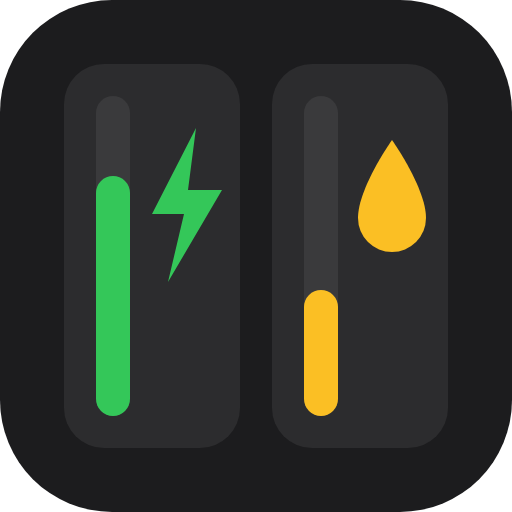
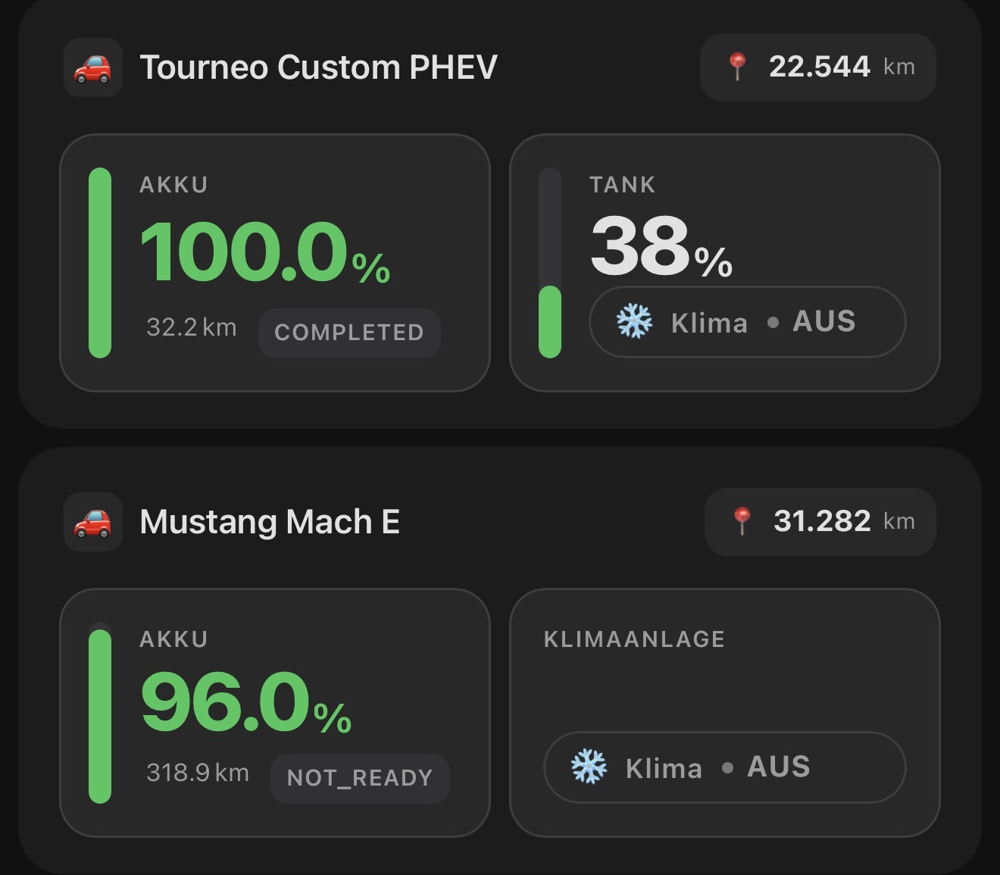

<p align="center"></p>

# Vehicle Card

A Home Assistant Lovelace custom card for displaying vehicle status. Works with any brand — fully configurable with your own entities.

 



📖 Mehr Hintergrund, Screenshots und FAQ im Blogartikel: [Vehicle Card für Home Assistant auf itrend24.de](https://itrend24.de/vehicle-card-home-assistant/)

## Features

- 🔋 Battery level with color-coded vertical bar (green / yellow / red)
- 📏 Estimated range — shown below battery percentage
- ⚡ Charge status badge inside the battery tile (Lädt / Verbunden / Bereit)
- ⛽ Fuel level with warning colors (for hybrids / combustion vehicles)
- 📏 Fuel range — shown below the fuel level, independent of the battery range (optional; works for combustion and plug-in hybrid vehicles, or on its own without a fuel level)
- ❄️ Climate toggle — switchable directly from the card (inside fuel tile, or standalone for EVs)
- 📍 Odometer — displayed as a pill chip in the card header
- 🎨 Custom icon — choose any MDI icon via the visual editor
- 🌐 Translatable UI text — auto-detects your Home Assistant language (German/English built in), or override individual labels
- 🌙 Dark & modern tile-based design using HA CSS variables

All fields are optional — unconfigured fields are simply hidden.

## Installation

### HACS (empfohlen)

1. HACS öffnen → **Frontend**
2. Nach **Vehicle Card** suchen und **Download** klicken
3. Browser neu laden (Strg+Shift+R)

Falls die Karte in deiner HACS-Version noch nicht in der Liste erscheint, kann sie als benutzerdefiniertes Repository hinzugefügt werden: Drei-Punkte-Menü → **Custom repositories** → `https://github.com/Cangos655/vehicle-card` → Kategorie **Lovelace**.

### Manuell

1. `vehicle-card.js` aus dem [neuesten Release](https://github.com/Cangos655/vehicle-card/releases/latest) herunterladen
2. In den HA-Ordner `config/www/` kopieren
3. Als Lovelace-Ressource hinzufügen:
   - **URL:** `/local/vehicle-card.js`
   - **Typ:** JavaScript-Modul
4. Browser neu laden (Strg+Shift+R)

## Configuration

### Visual Editor

The card includes a full GUI editor. All fields including the icon can be configured without YAML.

### YAML

```yaml
type: custom:vehicle-card
name: Mein Auto                          # optional, default: "Fahrzeug"
icon: mdi:car-electric                   # optional, default: 🚗
battery_level: sensor.car_battery        # optional
battery_range: sensor.car_range          # optional
charge_status: sensor.car_charging       # optional
charge_state_charging: "charging"        # optional, default: "charging"
charge_state_plugged: "plugged_in"       # optional, default: "plugged_in"
fuel_level: sensor.car_fuel              # optional
fuel_range: sensor.car_fuel_range        # optional, unit (km / mi) is taken from the sensor
odometer: sensor.car_odometer            # optional
climate: switch.car_climate              # optional
language: auto                           # optional, "auto" | "de" | "en", default: "auto"
labels:                                  # optional, overrides individual text strings
  battery: "Battery"
  fuel: "Fuel"
  climate: "Climate"
  climate_tile: "Climate"
  odometer: "Odometer"
  "on": "ON"
  "off": "OFF"
  charging: "Charging"
  plugged: "Plugged in"
  ready: "Ready"
  vehicle: "Vehicle"
  empty: "No entities configured"
```

### Language & Labels

- `language: auto` (default) uses Home Assistant's configured UI language. German and English are built in; any other language falls back to English.
- Set `language: de` or `language: en` to force a specific language regardless of the HA UI language.
- Use `labels` to override any individual string, in any language — this always wins over the built-in translation, so you can mix languages or use custom wording.

## Warning Colors

| Condition | Color |
|---|---|
| Battery ≥ 50% | 🟢 Green |
| Battery 20–50% | 🟡 Yellow |
| Battery < 20% | 🔴 Red |
| Fuel ≥ 30% | Default |
| Fuel 15–30% | 🟡 Yellow |
| Fuel < 15% | 🔴 Red |

## Charge Status Badge

Shown inside the battery tile. Adapts to your entity type:

- **`binary_sensor`**: `on` → "charging" label (green), `off` → "ready" label (gray)
- **`sensor`**: mapped via `charge_state_charging` / `charge_state_plugged` config keys; unmapped states are shown as-is

## Layout

- **Pure EV** (no fuel): Battery tile + Climate tile side by side
- **Hybrid / combustion**: Battery tile (with range + charge status) + Fuel tile (with optional fuel range and climate toggle)
- **Fuel range only** (no `fuel_level`): the Fuel tile shows the range as its main value, without a bar
- **Header**: Car name with custom icon + odometer pill chip

## License

MIT
